# Tripy 2.0 화면 플로우

> 기준: Figma `Tripy 2.0.0_flow` (node 1376:3287) — https://www.figma.com/design/w37qKy85KqUyLuo9LQGJTU/?node-id=1376-3287
> 2.0 리뉴얼의 화면 순서·전환은 이 문서를 따른다. Figma가 바뀌면 이 문서도 같이 고친다.

## 1. 메인 플로우 (정상 경로)

```mermaid
flowchart LR
    S01[01 앱 시작] --> S03[03 온보딩]
    S03 -->|구글 로그인 / 일단 둘러보기| S04[04 여행 정보 입력]
    S04 -->|필수값 입력| S05[05 여행 정보 완료]
    S05 -->|다음| S06[06 정보 확인 바텀시트]
    S06 -->|수정| S05
    S06 -->|확인| S07[07 홈 · 빈 상태]
    S07 -->|FAB +| S08[08 지출 등록]
    S08 -->|추가하기| S09[09 등록 완료 · 홈]
    S09 -->|탭: 지난 여행| S10[10 지난 여행]
    S10 -->|여행 카드| S11[11 여행 상세]
    S11 -->|탭: 마이페이지| S12[12 마이페이지]
```

> Figma에 `02` 번호 화면은 없다(01 → 03).

## 2. 화면별 정의

| # | 화면 | 라우트(2.0) | 구성 | 다음 화면 / 전환 |
|---|---|---|---|---|
| 01 | 앱 시작 | `/` | 로고, "여행 비용 정리 / 트리피에서 간단하게". 버튼 없음 | 자동으로 03 |
| 03 | 온보딩 | **[결정 필요]** 현재는 `/`가 겸함 | 로고, 캐릭터, "여행 비용 정리는 이제 트리피에서!", `구글 로그인`, `일단 둘러보기` + 게스트 저장 안내 캡션(§5) | 두 버튼 모두 → 04. 로그인한 사용자에게는 보이지 않음 |
| 04 | 여행 정보 입력 | `/setup` | 헤더(뒤로), "떠날 여행을 등록해주세요". 여행지(국가 검색), 기간(출발일~도착일, `당일치기예요`), 예산(통화 선택 + 금액). 안내 "여행 일정은 나중에도 변경할 수 있어요!". `다음` 비활성 | 입력 완료 시 05 상태 |
| 05 | 여행 정보 완료 | `/setup` (같은 화면, 입력 완료 상태) | 기간 라벨 옆 `N박N일`, 예산 라벨 옆 `3백만 원` 같은 요약. `다음` 활성 | `다음` → 06 |
| 06 | 정보 확인 | `/setup` 위 **바텀시트** (라우트 아님) | "입력한 여행 정보를 확인해주세요" — 여행지·기간(N박N일)·예산 요약, `수정` / `확인` | `수정` → 시트 닫고 05, `확인` → 여행 생성 후 07 |
| 07 | 홈 (빈 상태) | `/home` | 헤더 로고, 여행명·날짜·N박N일, 오늘 쓴 돈 / 남은 금액 / 총 예산·소비율, "아직 등록된 지출 내역이 없어요." FAB + 툴팁 "경비를 등록해 볼까요?", 하단 탭 | FAB → 08 |
| 08 | 지출 등록 | `/expense` | 헤더 "경비 등록"(뒤로, 닫기). 통화 + 금액, 결제 수단*(카드/현금), 카테고리(숙소·식비·교통·액티비티·쇼핑·기타·+), 지출 날짜*, 지출 내용. `추가하기` | `추가하기` → 09, 뒤로/닫기 → 홈 |
| 09 | 등록 완료 · 홈 | `/home` | 07 + 금액 갱신, "지출 내역" 리스트(카테고리, 날짜, 금액) + 필터 아이콘 | 지출 항목 → 08(수정 모드), 하단 탭 이동 |
| 10 | 지난 여행 | `/travels` | 헤더 "지난 여행". 여행 카드: 국기, 여행명, D+N 칩, 기간, "예산 N% 사용"/"예산 N% 초과" + 진행바(초과 시 빨강). **`+ 새 여행` 버튼(Figma 미반영)** | 카드 → 11, `+ 새 여행` → 04 |
| 11 | 여행 상세 | `/travels/[id]` **(신규)** | 헤더(뒤로), 국기+여행명, 기간, D+N. 총 지출 / 남은 금액 / 총 예산·소비율. "지출 내역" — 정렬(등록순)·필터, **N일 차별 그룹**(날짜, 일 합계) | 지출 항목 → 08(수정 모드), 뒤로 → 10 |
| 12 | 마이페이지 | `/mypage` | 헤더 "마이페이지" + 설정 아이콘. 프로필(닉네임 >, 칭호, 배지), "여행 N회째!"(지출 총액, 여행 일수), 카테고리 내역 순위(가로 스크롤, 업데이트 일자), `로그아웃`. **게스트는 로그아웃 대신 `구글 로그인` + 안내 캡션(Figma 미반영)** | 설정 아이콘 → `/mypage/settings`, 닉네임 → `/mypage/profile` |

## 3. 하단 탭 (BottomNav)

- 순서와 라벨: **홈 · 지난 여행 · 마이페이지** (`/home`, `/travels`, `/mypage`)
- 탭이 보이는 화면: 07, 09, 10, 11, 12. 01~06·08에는 탭이 없다.
- 11 여행 상세에서는 `지난 여행` 탭이 활성 상태다 → `/travels/*` 하위 경로도 `지난 여행` 탭으로 표시한다.

## 4. 전환 규칙

- 03의 두 버튼 모두 04로 간다. 로그인 방식과 관계없이 **여행 정보 입력이 첫 단계**다.
- 06의 `확인`에서만 여행을 생성(INSERT)한다. 04·05·06은 입력값을 한 화면 상태로 유지하고, 중간 단계마다 저장하지 않는다.
- 06은 바텀시트다. 라우트를 바꾸지 않으므로 `수정`은 시트만 닫는다.
- 08 `추가하기` 후에는 홈으로 돌아가고(09), 스택에 08이 남지 않게 한다(`replace`).
- 홈(07/09)은 여행이 이미 있는 사용자의 시작 화면이다. 여행이 없으면 04로 보낸다. 이때 여행 데이터를 다 불러오기 전에는 판단하지 않는다(로딩 중에 `/setup`으로 보내지 말 것).
- 재진입: 01 다음에 **로그인 상태(또는 기기에 게스트 데이터 있음) → 홈 여행 있으면 07, 없으면 04**. 로그인도 게스트 데이터도 없으면 03.
- 08은 등록과 수정을 겸한다. 지출 항목에서 들어오면 값이 채워진 수정 모드이고, 수정·삭제할 수 있다.

## 5. 결정 사항 (2026-10-21)

Figma 플로우에 없는 로직은 아래로 정했다. 디자인이 필요한 항목은 "Figma 미반영"으로 표시했다.

### 게스트(일단 둘러보기)
- 게스트가 만든 여행·지출은 **이 기기(브라우저 localStorage)에만** 저장한다. Supabase 익명 로그인은 쓰지 않는다.
- 게스트의 구글 로그인 진입점은 **12 마이페이지의 `구글 로그인` 버튼**이다. 로그인하면 기기 데이터를 계정으로 옮기고 기기 사본은 지운다.
- 게스트에게는 기기에만 저장된다는 사실을 **캡션으로 반드시 알린다**(Figma 미반영). 위치: 03의 `일단 둘러보기` 버튼 아래, 12의 `구글 로그인` 버튼 아래. 문구 예: "로그인하지 않으면 이 기기에만 저장되고, 다른 기기나 브라우저에서는 볼 수 없어요."

### 여러 여행
- 새 여행은 **10 지난 여행의 `+ 새 여행` 버튼**에서 만든다(Figma 미반영). 버튼 → 04.
- 홈에 보여줄 여행: **진행 중(오늘이 기간 안) 여행 → 없으면 출발일이 가장 가까운 예정 여행**. 둘 다 없으면 04로 보낸다.
- 도착일이 지나면 그 여행은 **자동으로 10 지난 여행 목록으로만** 보인다. 별도의 "여행 종료" 액션은 없다.

### 닉네임
- 가입 시 **자동 생성**한다(구글 이름 또는 랜덤). 수정은 12 → `/mypage/profile`. `/nickname` 화면은 2.0 플로우에서 빠진다.

### 지출 수정·삭제
- 09 홈과 11 여행 상세의 지출 항목을 누르면 **08을 수정 모드로** 연다. 수정·삭제가 가능하고, 저장 후 들어온 화면으로 돌아간다.

### 저장과 실패 처리 (2026-10-29 추가)
- **여행 생성은 insert 한 번이다.** 06 `확인`에서 여행지·기간·예산(`total_budget`, `currency`)을 한 번에 insert한다. 1.x처럼 `total_budget: 0`으로 만든 뒤 예산을 update하지 않는다. 그래야 여행만 저장되고 예산이 빠지는 경우가 없다.
- **등록과 수정은 따로 처리한다.** 화면을 같이 써도 수정 모드는 기존 id를 update하고 새로 insert하지 않는다(08 지출, 여행 정보 수정 모두).
- **제출 중에는 버튼을 비활성화한다.** 06 `확인`과 08 `추가하기`를 여러 번 눌러도 중복으로 생성되지 않게 한다.
- **실패하면 입력값을 유지한다.** 저장 실패 시 홈으로 보내지 않는다. 화면(06은 시트 포함)과 입력값을 그대로 두고 다시 시도할 수 있게 한다. 홈으로 이동(`replace`)하는 건 저장에 성공했을 때만이다.
- **날짜는 날짜 값으로만 다룬다.** `YYYY-MM-DD` 문자열로 저장하고 `Date`↔UTC 변환을 거치지 않는다. 시간대 때문에 하루가 밀리면 안 된다. 도착일 ≥ 출발일이고, 당일치기는 두 날짜가 같다. `N박N일`은 날짜로 계산한다(박 = 날짜 차이, 일 = 박 + 1). 따로 저장하지 않는다.
- **조회는 저장이 아니다.** 홈·지난 여행·여행 상세·마이페이지에 들어가거나 탭을 바꾸는 것만으로 생성·수정 요청을 보내지 않는다. 지난 여행으로 옮기는 것도 날짜 비교로만 판단하고 DB에 쓰지 않는다.

## 6. 1.x 대비 변경점 (코드 반영 필요)

| 항목 | 1.x (현재 코드) | 2.0 |
|---|---|---|
| 여행 설정 | `setup` → `setup/country` → `setup/region` → `setup/date` → `setup/confirm` → `budget` (6화면) | `/setup` 한 화면 + 확인 바텀시트 |
| 예산 입력 | 별도 `/budget` 화면 | 04 여행 정보 입력 안에 포함 |
| 예산 저장 | `total_budget: 0`으로 insert 후 `/budget`에서 update | 06 `확인`에서 여행과 함께 한 번에 insert |
| 지역(region) 선택 | 있음 | 플로우에 없음 (여행지 = 국가 검색) |
| 닉네임 설정 | 로그인 후 `/nickname` | 자동 생성, 마이페이지에서 수정 |
| 게스트 | Supabase 익명 로그인으로 DB 저장 | 기기(localStorage)에만 저장, 로그인 시 이전 |
| 홈 여행 선택 | `created_at` 최신 1개 | 진행 중 > 가장 가까운 예정 |
| 지출 수정·삭제 | 없음 | 08 수정 모드 |
| 스플래시/온보딩 | `/` 한 화면에 로그인 버튼 | 01 앱 시작 → 03 온보딩으로 분리 |
| 여행 상세 | 없음 (`travels`에서 바로 편집) | `/travels/[id]` 신규 |
| 하단 탭 | 여행 관리 · 홈 · 마이페이지 | 홈 · 지난 여행 · 마이페이지 |

## 7. 확인 필요

- **03 온보딩 라우트:** `/`를 01 전용으로 두고 03을 별도 라우트(예: `/onboarding`)로 분리할지.
- **게스트 안내 문구:** "화면을 벗어나면 저장되지 않는다"는 표현은 localStorage 동작(창을 닫아도 남고, 브라우저 데이터 삭제·다른 기기에서만 사라짐)과 다르다. 최종 문구 확정 필요.
- **지역(region):** 여행지를 국가 단위로만 받는지. 지역을 남기면 국가를 바꿀 때 지역값을 초기화한다.
- **예산 미입력 허용:** Figma 04는 예산까지 입력해야 `다음`이 활성화된다. 1.x의 "나중에 할게요"처럼 예산을 비워 둘 수 있게 한다면, 미설정은 `null`로 저장하고 0원과 구분한다. 홈에는 "예산 미설정"으로, 남은 금액·소비율은 "—"로 표시한다. 이 경우 `total_budget` nullable 마이그레이션이 필요하고, 기존 데이터의 `0`이 "미설정"인지 "0원"인지 먼저 확인해야 한다(1.x는 예산을 건너뛰어도 0이 남는다).
- **입력 중 이탈 확인:** 04에서 입력한 내용이 있을 때 뒤로 가면 "계속 입력 / 나가기" 확인을 띄울지. Figma에 없는 UI라 디자인 결정이 필요하다. 06 정보 확인과는 별개다.
- **10 지난 여행 목록 범위:** 진행 중·예정 여행도 이 목록에 넣는지(Figma 레이어에 숨겨진 `Ongoing Trips | Completed Trips` 탭이 있음). `+ 새 여행` 버튼 디자인.
- **여행 정보 수정:** 11 여행 상세에서 여행 정보(기간·예산)를 고치는 진입점. 04 안내 문구는 "나중에도 변경할 수 있어요"라고 한다.
- **기존 라우트 정리:** `nickname`, `setup/{country,region,date,confirm}`, `budget`, `travels/[id]/edit`를 삭제할지 리다이렉트로 남길지.
