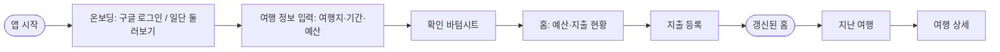

# Tripy 2.0 PRD

> 2.0 리뉴얼 기준 PRD. 화면 순서·전환과 세부 로직은 `docs/flow-v2.md`(Figma `Tripy 2.0.0_flow` 정리본)가 기준이다.
> 최종 수정: 2026-10-21 (1.x MVP PRD에서 2.0 플로우 반영)

## 1. 서비스 개요

| 항목 | 내용 |
|---|---|
| 서비스 한 줄 설명 | 여행 예산과 지출을 기록하고, 남은 금액과 소비 현황을 확인하는 여행 경비 관리 서비스 |
| 해결하려는 사용자 문제 | 여행 중 지출이 여러 항목에 흩어져 현재 지출과 남은 예산을 빠르게 파악하기 어렵다. |
| 핵심 목표 | 여행 정보 설정 → 지출 기록 → 예산·지출 현황 확인의 핵심 흐름을 간단하게 제공한다. |
| 주요 타겟 사용자 | 여행 예산을 관리하려는 20~30대 개인·커플·친구 여행자 |

## 2. 핵심 기능

### 2.1 시작·로그인

- **목적:** 가입 부담 없이 바로 여행을 등록하게 한다.
- **사용자 행동:** `구글 로그인` 또는 `일단 둘러보기`(게스트)를 고른다.
- **완료 조건:** 둘 다 바로 여행 정보 입력으로 이어진다.
- **규칙:**
  - 게스트 데이터는 이 기기(브라우저)에만 저장된다. 게스트에게는 이 사실을 캡션으로 알린다.
  - 게스트는 마이페이지의 `구글 로그인`으로 계정을 만들고, 이때 기기 데이터를 계정으로 옮긴다.
  - 닉네임은 가입 시 자동 생성되고, 마이페이지 > 프로필에서 수정한다.
  - 다시 들어온 사용자는 온보딩을 건너뛴다. 홈에 보여줄 여행이 있으면 홈, 없으면 여행 정보 입력으로 간다.

### 2.2 여행 설정

- **목적:** 경비를 기록할 여행 단위를 만든다.
- **사용자 행동:** 한 화면에서 여행지(국가), 기간(출발일~도착일 또는 당일치기), 예산(통화·금액)을 입력하고, 확인 바텀시트에서 확정한다.
- **완료 조건:** 확인 바텀시트의 `확인`을 누르면 여행이 생성되고 홈으로 이동한다.
- **규칙:**
  - 새 여행은 지난 여행 화면의 `+ 새 여행`에서 만든다. 여행은 여러 개 가질 수 있다.
  - 홈에는 진행 중인 여행을 보여주고, 없으면 출발일이 가장 가까운 예정 여행을 보여준다.
  - 도착일이 지난 여행은 자동으로 지난 여행 목록으로 옮겨진다.

### 2.3 지출 기록

- **목적:** 여행 중 발생한 비용을 빠르게 기록한다.
- **사용자 행동:** 금액(통화), 결제 수단(카드/현금)*, 카테고리(숙소·식비·교통·액티비티·쇼핑·기타), 지출 날짜*, 지출 내용을 입력해 저장한다.
- **완료 조건:** 홈의 오늘 쓴 돈·남은 금액·지출 내역에 즉시 반영된다.
- **규칙:** 지출 항목을 누르면 같은 화면이 수정 모드로 열리고, 수정·삭제할 수 있다.

### 2.4 예산·지출 현황 확인

- **목적:** 현재 소비 상태를 파악한다.
- **사용자 행동:** 홈에서 오늘 쓴 돈·남은 금액·총 예산 대비 소비율과 지출 내역을 확인한다.
- **완료 조건:** 최신 지출 기준의 요약이 표시된다.

### 2.5 지난 여행·여행 상세

- **목적:** 지난 여행의 예산 사용 결과와 지출 내역을 돌아본다.
- **사용자 행동:** 여행 목록에서 예산 사용률(초과 시 강조)을 보고, 여행을 눌러 상세를 확인한다.
- **완료 조건:** 상세에서 총 지출·남은 금액과 일차별 지출 내역(정렬·필터)이 표시된다.

### 2.6 마이페이지

- **목적:** 내 여행 기록을 요약해 보고 계정을 관리한다.
- **사용자 행동:** 프로필(닉네임·칭호), 여행 횟수·지출 총액·여행 일수, 카테고리별 지출 순위를 확인한다. 설정과 로그아웃(게스트는 구글 로그인)을 한다.

## 3. Later

| 기능 | 상태 |
|---|---|
| 동행자 공유·공동 정산 | 확장 기능. 권한과 정산 기준은 **[확인 필요]** |
| 상세 통계 | 마이페이지 카테고리 순위 이상의 지표와 범위는 **[확인 필요]** |

## 4. 핵심 User Flow

**메인 플로우**

앱 시작 → 온보딩 → 여행 정보 입력 → 확인 바텀시트 → 홈 → 지출 등록 → 갱신된 홈 → 지난 여행 → 여행 상세 → 마이페이지

## 5. 필요한 화면

| 화면명 | 화면 목적 | 핵심 액션 | 다음 화면 |
|---|---|---|---|
| 앱 시작 | 브랜드 노출, 로그인 상태 판별 | (자동) | 온보딩 / 홈 / 여행 정보 입력 |
| 온보딩 | 로그인 방식 선택 | 구글 로그인, 일단 둘러보기 | 여행 정보 입력 |
| 여행 정보 입력 | 여행지·기간·예산을 한 화면에서 입력 | 입력 후 다음, 확인 바텀시트에서 확정 | 홈 |
| 홈 | 현재 여행의 오늘 쓴 돈·남은 금액·소비율·지출 내역 확인 | 지출 추가(FAB), 지출 항목 수정 | 지출 등록 |
| 지출 등록 | 지출 기록·수정·삭제 | 금액·결제 수단·카테고리·날짜·내용 입력 후 저장 | 홈 |
| 지난 여행 | 여행 목록과 예산 사용률 확인, 새 여행 시작 | 여행 선택, `+ 새 여행` | 여행 상세 / 여행 정보 입력 |
| 여행 상세 | 여행별 총 지출과 일차별 지출 내역 확인 | 정렬·필터, 지출 항목 수정 | 지출 등록 |
| 마이페이지 | 프로필·여행 기록 요약·카테고리 순위 | 프로필 수정, 설정, 로그아웃 / 구글 로그인 | 프로필 / 설정 |

하단 탭: 홈 · 지난 여행 · 마이페이지

## 6. 확인 필요

`docs/flow-v2.md` §7과 같은 목록이다. 결정되면 두 문서를 함께 고친다.

- **온보딩 라우트:** 앱 시작과 온보딩을 별도 라우트로 나눌지
- **게스트 안내 문구:** 최종 캡션 문구
- **여행지 범위:** 국가 단위만 받는지(지역 선택 제거 여부)
- **지난 여행 목록 범위:** 진행 중·예정 여행 포함 여부, `+ 새 여행` 버튼 디자인
- **여행 정보 수정 정책:** 여행 상세에서 기간·예산을 고치는 진입점
- **카테고리 기본값 및 편집 범위:** 지출 등록의 `+`(카테고리 추가) 동작
- **1.x 라우트 정리:** `nickname`, `setup/*`, `budget`, `travels/[id]/edit` 삭제 또는 리다이렉트
